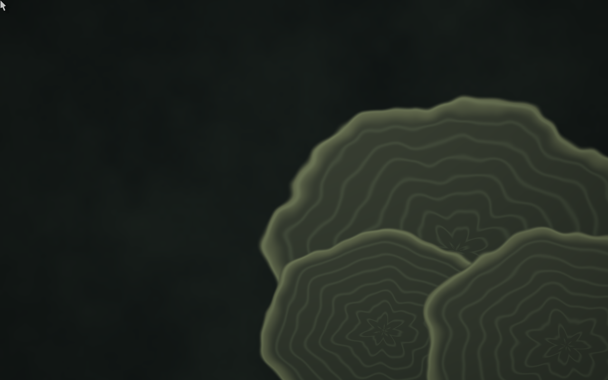

# fungOS

Debian-based nodes with explicit boot profiles, secure enrollment and trusted
software delivery. Mycelium manages identity, topology, access and updates;
optional edge profiles add Unibus and the native Canvas Wayland compositor.

[Website](https://fungos.dev) · [Website source](https://github.com/ajmwagar/fungos-web) · [Mycelium](https://github.com/ajmwagar/mycelium)


Actual QEMU framebuffer capture, 6 October 2026—not a mockup. See
[screenshot provenance](docs/screenshots/README.md). These are development
builds, not a stable distribution release.

## First public slice

This repository contains the generic [base filesystem builder](base/README.md),
capability-derived Debian package sets and `base`, `edge`, `headless-edge`, and
`cloud` declarations for `amd64` and `arm64`.

The builder produces a **rootfs tarball**, not a ready-to-flash SD card or
installer ISO. Board firmware, kernels, boot installation, enrollment and
signed first-party executables remain separate integration steps. The existing
QEMU, Pi and cloud qualification work is being separated from the Mycelium
development checkout; it is not all migrated here yet.

## Check and build

Validate the declarations without building an image:

```sh
./base/scripts/check.sh
```

On a Debian Linux build host with `mmdebstrap`, the Debian archive keyring and
the required privileges:

```sh
sudo ./base/scripts/build.sh amd64 base
sudo ./base/scripts/inspect.sh base/out/fungos-base-amd64.tar
```

See the [runbook](base/RUNBOOK.md) for prerequisites and cross-architecture
builds. Snapshot inputs live in [`base/config/release.env`](base/config/release.env).
No signing authority, private key, enrollment claim or fleet credential is
included in the source or generic base image.

## Edge desktop



Canvas and Unibus remain independent projects. The image profile supplies
their runtime dependencies; it does not fork their implementations or grant
discovered devices access automatically.

## License

First-party code and documentation: **MIT OR Apache-2.0**, at your option.
See [LICENSE](LICENSE), [LICENSE-MIT](LICENSE-MIT) and
[LICENSE-APACHE](LICENSE-APACHE).

Generated distributions contain separately licensed components. Linux, Debian
packages, board firmware and optional applications retain their own terms;
the complete image is not uniformly MIT/Apache. See [THIRD-PARTY.md](THIRD-PARTY.md).

The initial base source was extracted from Mycelium commit
`fbb768b`; [ORIGIN.md](ORIGIN.md) records the import boundary.
